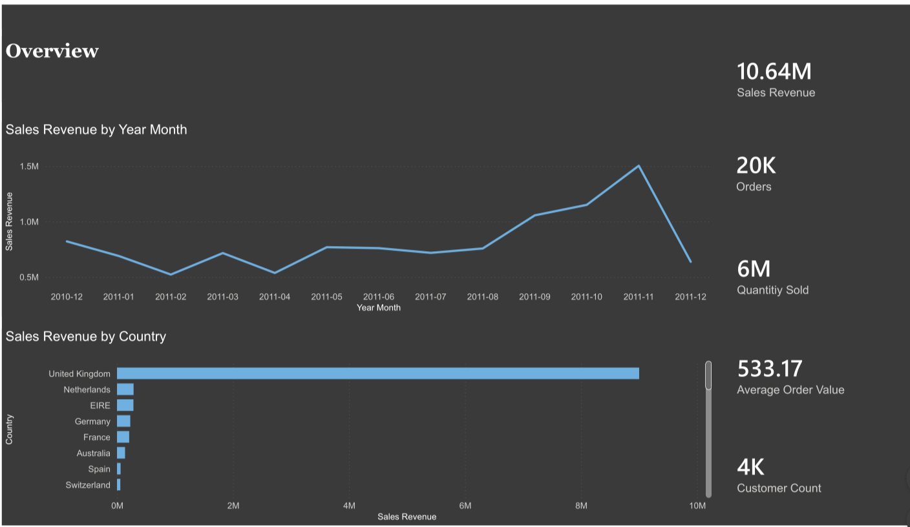
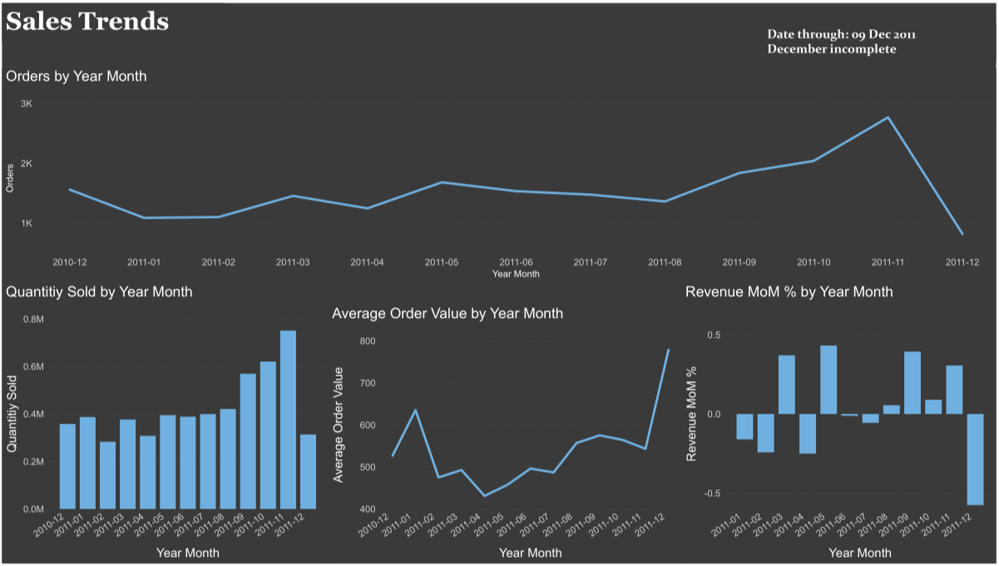
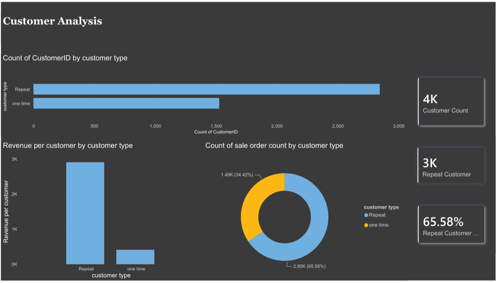
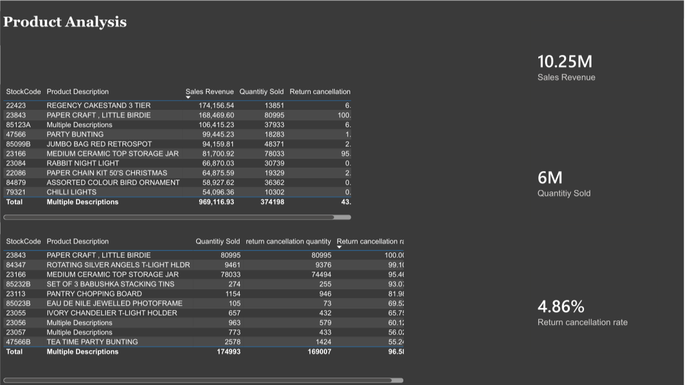
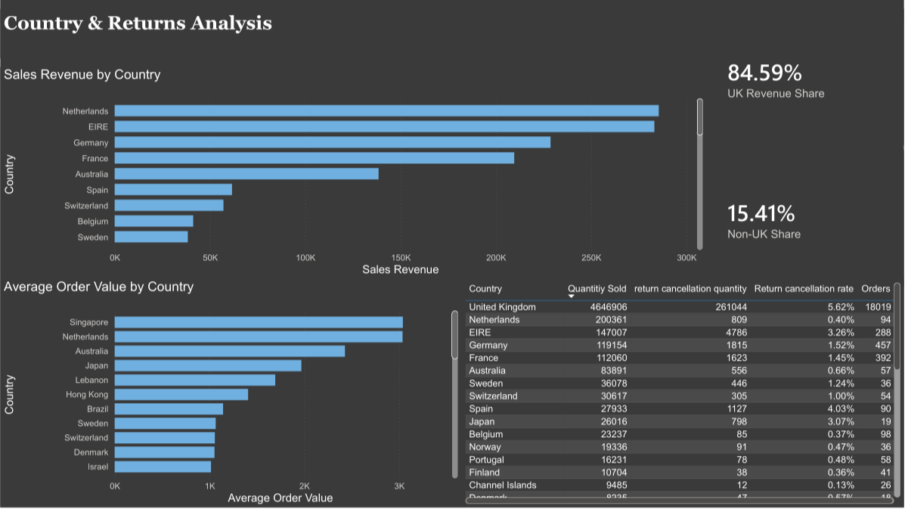

# E-Commerce Sales Analysis

## Overview

This project is an end-to-end e-commerce data analysis project built around the **Online Retail** dataset.

The project covers the full analytical workflow, from raw data auditing and cleaning to SQL-based analysis and an interactive **Power BI dashboard**.

## Project Objectives

- Analyze overall sales performance and trends
- Identify top-performing products
- Analyze customer purchasing behavior
- Examine sales performance across countries
- Analyze returns and non-commercial transactions
- Transform the data into a structure suitable for business analysis
- Present the results through an interactive Power BI dashboard

## Tools & Technologies

- **Python** — data auditing and cleaning
- **Pandas** — data manipulation and preprocessing
- **PostgreSQL** — data analysis and querying
- **SQL** — business and analytical queries
- **Power BI** — dashboard development and visualization
- **Git & GitHub** — version control and project management

## Project Workflow

```text
Raw Dataset
    ↓
Data Audit
    ↓
Data Cleaning & Preprocessing
    ↓
Processed Data
    ↓
PostgreSQL
    ↓
SQL Analysis
    ↓
Power BI Dashboard
```

## Project Structure

```text
ANALYSIS-PROJECT/
│
├── Dashboard/
│   ├── 1.png
│   ├── 2.png
│   ├── 3.png
│   ├── 4.png
│   ├── 5.png
│   └── ecommerce_analysis.pdf
│
├── data/
│   ├── processed/
│   │   ├── non_commercial_data.csv
│   │   └── stock_adjustments.csv
│   │
│   └── raw/
│       └── Online Retail.xlsx
│
├── scripts/
│   ├── 01_data_audit.py
│   └── 02_clean_data.py
│
├── sql/
│   ├── country_returns_analysis.sql
│   ├── customer_analysis.sql
│   ├── product_analysis.sql
│   ├── sales_trends.sql
│   └── schema/
│       └── 01_create_schemas.sql
│
├── data_audit.md
├── project1.md
└── README.md
```

## Data Preparation

The raw dataset was first examined through a dedicated data-auditing process to identify data-quality issues and understand the structure of the data.

Python was then used for cleaning and preprocessing, including preparing the data for downstream SQL analysis.

The main data-preparation scripts are:

- `01_data_audit.py`
- `02_clean_data.py`

Additional processed datasets were generated for specific analytical requirements.

## SQL Analysis

The cleaned data was analyzed using PostgreSQL.

The SQL layer contains analysis covering:

- **Sales Trends** — analyzing sales performance over time
- **Customer Analysis** — understanding customer purchasing behavior
- **Product Analysis** — identifying product-level performance
- **Country Returns Analysis** — analyzing returns across countries
- **Database Schema** — creating the required database structures

## Power BI Dashboard

The final analysis was visualized through a multi-page Power BI dashboard.

### Dashboard Preview











### Full Dashboard

[View the full Power BI dashboard PDF](Dashboard/ecommerce_analysis.pdf)

## Data

The project uses the **Online Retail** dataset.

The original dataset is included in:

```text
data/raw/Online Retail.xlsx
```

Large generated files and unnecessary temporary files are excluded through `.gitignore`.

## Key Insights

The Power BI dashboard provides a visual analysis of the dataset, allowing exploration of:

- Sales trends
- Product performance
- Customer behavior
- Geographic performance
- Returns
- Non-commercial transactions

## Author

**Mohamed Abdelsattar**

GitHub: [@mohamm010](https://github.com/mohamm010)